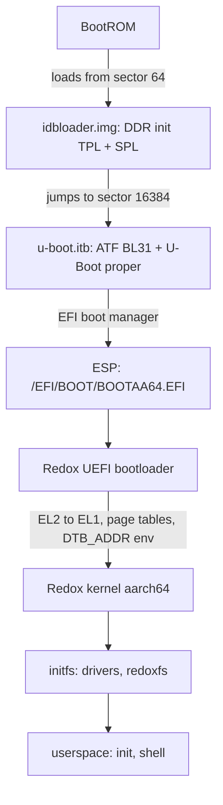

# Redox OS on Pinebook Pro

Porting [Redox OS](https://www.redox-os.org) (aarch64) to the [PINE64 Pinebook Pro](https://pine64.org/documentation/Pinebook_Pro/) (Rockchip RK3399 laptop).

**End goal:** a GitHub Actions workflow that produces a bootable disk image — flash it to a microSD card with `dd`, insert into the Pinebook Pro, and boot Redox OS.

**Current stage:** research / preparation. The implementation checklist below tracks all remaining work.

---

## 1. Target hardware: Pinebook Pro

Verified against the official PINE64 wiki ([Pinebook Pro page](https://wiki.pine64.org/wiki/Pinebook_Pro)):

| Component      | Details                                                                                                                                                                   |
| -------------- | ------------------------------------------------------------------------------------------------------------------------------------------------------------------------- |
| SoC            | Rockchip **RK3399**: 2× Cortex-A72 @ 2.0 GHz + 4× Cortex-A53 @ 1.5 GHz, ARMv8-A (AArch64)                                                                                 |
| RAM            | 4 GB LPDDR4                                                                                                                                                               |
| Storage        | eMMC module (v5.1, HS400, **SDHCI/arasan** `fe330000`), microSD (**DW MMC**), SPI NOR 16 MiB (ships **empty**), M.2 NVMe via PCIe Gen1 x4 (**not bootable** from BootROM) |
| Serial console | UART2 via headphone jack (internal switch), **1500000 baud 8N1**, 3.3 V logic                                                                                             |
| Input          | Keyboard + touchpad are **USB HID** devices behind an internal USB 2.0 hub                                                                                                |
| Display        | 14" 1920×1080 IPS, eDP (BOE NV140FHM-N49); eDP/VOP not driven by U-Boot GOP on all firmwares                                                                              |
| GPU            | Mali-T860MP4 (Midgard) — out of scope, no driver upstream                                                                                                                 |
| Wi-Fi/BT       | AMPAK **AP6256** (Broadcom), Wi-Fi via SDIO, BT via UART                                                                                                                  |
| Audio          | Everest ES8316 codec, RK808 PMIC                                                                                                                                          |
| USB            | 1× USB 2.0 Type-A, 1× USB 3.0 Type-A, 1× USB 3.0 Type-C (OTG + DP alt-mode, power)                                                                                        |
| Boot ROM order | **SPI NOR → eMMC → microSD → USB OTG** (USB-C not bootable)                                                                                                               |
| Recovery       | MaskROM mode via internal Recovery button + `rkdeveloptool`                                                                                                               |

### RK3399 boot chain (from microSD)

The BootROM loads the next stage from **byte offset 32768 (sector 64)** of the boot device:



Mainline U-Boot supports the board as `pinebook-pro-rk3399_defconfig` (DT: `rk3399-pinebook-pro.dts`).
[TOW-Boot](https://github.com/Tow-Boot/Tow-Boot) (an opinionated U-Boot distribution with a friendly boot menu) ships the board as **`pine64-pinebookPro`**.

On SD/eMMC the first stage begins with a 512-byte **Rockchip v1 header** at sector 64.
The header is **RC4-encoded** with a fixed key (`tools/rkcommon.c`), so its plaintext
signature `0x0ff0aa55` is not visible on disk; the payload starts at `+0x800` with the
4-byte marker `RK33` (RK3399). `RKNS` is the **v2** header magic used by newer Rockchip
SoCs (RK3568/RK3588 class) — do not use it to verify an RK3399 image.

### Verified on the actual device (2026-11-19)

Full log and analysis: [`experiments/0-serial-console.md`](experiments/0-serial-console.md).

- UART2 console works at **1500000 8N1** (complete, ungarbled boot log).
- Current firmware: **U-Boot 2021.07-1 (Manjaro ARM)**, EFI distro boot with the default
  environment — `boot_targets=usb0 mmc1 mmc0 nvme0 pxe dhcp sf0`; autoboot is
  interruptible and the `=>` console is available.
- SPI NOR is detected (`gd25q128`, 16 MiB); the U-Boot environment there is invalid
  (`bad CRC`), so the built-in default environment is used.
- Runtime MMC mapping: `mmc0` = eMMC (SDHCI `fe330000`), `mmc1` = microSD (DW MMC
  `fe320000`), `mmc2` = SDIO/Wi-Fi (`fe310000`).
- eMMC holds the baseline OS (GPT; first partition at LBA 62500, i.e. 32 MiB, leaving
  room for an embedded U-Boot at 8 MiB) — it stays untouched.
- Practical consequence: the existing firmware can boot a Redox `BOOTAA64.EFI` from the
  microSD ESP **without flashing anything**; manual `bootefi` from the U-Boot prompt
  enables fast iteration.
- Baseline OS: **Manjaro ARM, kernel 5.13.4-1-MANJARO-ARM**, hostname `pbp`; DT model
  `Pine64 Pinebook Pro`, compatible `pine64,pinebook-pro` + `rockchip,rk3399`.
- Linux reference drivers: `dwmmc_rockchip` (microSD `fe320000`, SDIO/Wi-Fi `fe310000`)
  and `sdhci`/`sdhci-pltfm` (eMMC `fe330000`, ADMA, HS200).
- **MMC numbering differs between U-Boot** (`mmc0`=eMMC, `mmc1`=microSD, `mmc2`=SDIO)
  **and Linux** (`mmc0`=SDIO, `mmc1`=microSD, `mmc2`=eMMC) — always identify by
  controller MMIO address.
- SPI NOR is exposed to Linux as `/dev/mtd0` (16 MiB, `spi0.0`, `gd25q128`) — it can be
  dumped for backup/inspection before any write.
- Internal keyboard is a USB HID device (`258a:001e`) on a USB 2.0 bus behind the
  Genesys Logic hub (`05e3:0608`); the webcam is `0c45:6321`.
- Serial login over `ttyS2` verified (`console=ttyS2,1500000` in the kernel cmdline).
- SPI NOR is **blank/erased**: sector 64 reads `0xFF` (so no v1 header can be present)
  and there are no `U-Boot` strings anywhere in the 16 MiB (full backup + SHA256 recorded
  in experiment 2).
- The shipped boot chain is the standard RK3399 one, in the **eMMC user area**: idbloader
  at **sector 64** and U-Boot proper at **sector 16384**. The first-stage header is the
  RC4-encoded v1 format (magic `0x0ff0aa55`), not ASCII `RKNS`; the eMMC hardware boot
  partitions (`boot0`/`boot1`, 4 MiB each) contain no bootloader and are unused
  (experiment 3).
- The microSD contains **no bootloader remnants** (zeros at sector 64, nothing at
  8 MiB) and can be safely overwritten.
- U-Boot `mmc info`: eMMC = MMC 5.1, High Speed 52 MHz, 8-bit; microSD = SD 3.0,
  High Speed 50 MHz, 4-bit.

---

## 2. Redox OS aarch64: current state (research summary)

Sources: `redox-os/kernel`, `redox-os/bootloader`, `redox-os/redox` (build system), Redox Book (`redox-os/book`), `HARDWARE.md`.

### What already exists upstream

| Piece                       | Status                                                                                                                                                                                                              | Evidence                                                                 |
| --------------------------- | ------------------------------------------------------------------------------------------------------------------------------------------------------------------------------------------------------------------- | ------------------------------------------------------------------------ |
| Kernel `aarch64` arch code  | Exists (`kernel/src/arch/aarch64/`)                                                                                                                                                                                 | `start.rs`, `paging.rs`, `vectors.rs`, `interrupt/`, `device/`           |
| Kernel target spec          | `kernel/targets/aarch64-unknown-kernel.json`                                                                                                                                                                        |                                                                          |
| FDT/DTB support             | Kernel consumes DTB via env `DTB_ADDR`/`DTB_SIZE`, exposes `/scheme/kernel.dtb`                                                                                                                                     | bootloader `src/main.rs` writes `DTB_ADDR`/`DTB_SIZE`; kernel `src/dtb/` |
| Serial console from DTB     | Supports compatibles `arm,pl011`, `ns16550a`, **`snps,dw-apb-uart`** (16550, u32 MMIO — exactly the RK3399 UART), Amlogic meson                                                                                     | `kernel/src/dtb/serial.rs`                                               |
| IRQ chips                   | RK3399 uses **GICv3** (`arm,gic-v3`, GIC-500): `gicv3.rs`. `gic.rs` (GICv2) and bcm2835/2836 exist but are not applicable. `irqchip::init_ap` (secondary CPUs) currently supports only the GICv2 memory-mapped path | `kernel/src/arch/aarch64/device/irqchip/`                                |
| Timer                       | ARM generic timer                                                                                                                                                                                                   | `device/generic_timer.rs`                                                |
| PSCI                        | Supported (`device/psci.rs`) — CPU bring-up / reset                                                                                                                                                                 |                                                                          |
| UEFI bootloader for aarch64 | Target `aarch64-unknown-uefi` → `BOOTAA64.EFI`; drops EL2→EL1, sets MAIR/TCR/page tables, reads EFI memory map & FDT, passes framebuffer via env                                                                    | `bootloader/src/os/uefi/arch/aarch64.rs`, `bootloader/src/main.rs`       |
| Build system multi-arch     | `ARCH=aarch64`, `CONFIG_NAME`, `BOARD` vars; image at `build/$ARCH/$CONFIG_NAME/harddrive.img`                                                                                                                      | Redox Book, `mk/`                                                        |
| aarch64 configs             | `config/aarch64/{ci,demo,dev,jeremy,redoxer}.toml` + `config/aarch64/raspi3bp/minimal.toml`                                                                                                                         |                                                                          |
| QEMU aarch64                | `make qemu` on aarch64 defaults to UEFI (`AAVMF`/`edk2-aarch64`), `-M virt`, `ramfb`, NVMe disk; U-Boot path also available                                                                                         | `mk/qemu.mk`                                                             |
| Real-hardware precedent     | **Raspberry Pi 3 B+ (ARM64, U-Boot): "Boots to UART serial console (pl011)"** — i.e. console-only, no storage driver yet                                                                                            | `HARDWARE.md`, Book chapter `aarch64.md`                                 |

### What is missing for a usable Pinebook Pro

1. **Storage drivers** for non-PCI hosts: DW MMC (microSD), SDHCI-arasan (eMMC). This is the biggest gap — it is why the RPi 3 B+ only reaches a serial console. Without it there is no root filesystem.
2. **USB host + HID** — needed for keyboard/touchpad (they are internal USB devices). Experiments 4 and 8 showed they sit on the **OHCI** companion of a RK3399 USB2 controller (U-Boot brings up no EHCI), so only an OHCI driver is required, not DWC2 or xHCI.
3. **Display**: framebuffer comes from the bootloader (`FRAMEBUFFER_ADDR` env) via EFI GOP; this only works if U-Boot exposes GOP (video driver for eDP in U-Boot). Otherwise console is serial-only until a Rockchip VOP/eDP driver exists. Note: U-Boot programs **RGB565** for the eDP panel (`rk_vop.c` forces `VIDEO_BPP16` for `VOP_MODE_EDP`) and reports it as a bit-mask format, so consumers must honour `FRAMEBUFFER_BPP` (experiment 7).
4. Optional/later: PCIe (NVMe), Wi-Fi AP6256, audio ES8316, RTC, battery/PMIC (RK808/CW2015).

**Pragmatic milestone plan:** serial console boot (parity with RPi 3 B+) → storage → USB input → display → everything else.

---

## 3. Target microSD image layout

The stock Redox installer (`redox-os/installer`) produces a GPT image with the ESP starting at **sector 2048 (1 MiB)** — which collides with the RK3399 requirement of placing `u-boot.itb` at **sector 16384 (8 MiB)**. Our CI therefore **repacks** the stock image: the ESP is recreated at 16 MiB and the U-Boot stages are embedded in the gap. The RedoxFS partition (and all its content) is left untouched.

Final image layout (512-byte sectors):

| Start sector | End sector | Size      | Content                                                        |
| ------------ | ---------- | --------- | -------------------------------------------------------------- |
| 0            | 33         | —         | Protective MBR + GPT header + entries                          |
| 64           | 16383      | ~8 MiB    | `idbloader.img` (RK3399 DDR init + SPL)                        |
| 16384        | ~18783     | ~1 MiB    | `u-boot.itb` (ATF BL31 + U-Boot proper, EFI-capable)           |
| 32768        | 264191     | ~113 MiB  | ESP, FAT32: `/EFI/BOOT/BOOTAA64.EFI` (Redox UEFI bootloader)   |
| 264192       | end        | remainder | RedoxFS (root filesystem with `/usr/lib/boot/{kernel,initfs}`) |

> **Note (2026-11-19, experiments 2–3):** the factory eMMC installation follows the same
> contract — idbloader at user-area **sector 64** and U-Boot proper at **8 MiB**; the eMMC
> hardware boot partitions contain no bootloader. The `RKNS` search in experiment 2 was a false
> negative: RK3399 uses the RC4-encoded v1 header (magic `0x0ff0aa55`, payload marker
> `RK33`), while `RKNS` is the v2 magic of newer SoCs. See
> `experiments/2-raw-sectors.md` and `experiments/3-emmc-boot-partitions.md`. The target
> SD layout above is unchanged; both bootloader offsets are now confirmed on the working
> eMMC install.

An alternative deployment mode (no image repacking needed): flash U-Boot/TOW-Boot once into the **SPI NOR** (it ships empty), then boot any stock-layout Redox image from microSD. This is documented as a fallback; the CI deliverable is the self-contained microSD image above.

---

## 4. Build system cheat sheet (upstream `redox` repo)

```sh
git clone https://gitlab.redox-os.org/redox-os/redox.git   # upstream primary (GitHub is a mirror)
cd redox

# .config (generated by CI, never committed)
cat > .config <<'EOF'
ARCH?=aarch64
CONFIG_NAME?=pinebook-pro
PODMAN_BUILD?=0
EOF

make all   # -> build/aarch64/pinebook-pro/harddrive.img
```

| Fact                           | Value                                                                                                                                                              |
| ------------------------------ | ------------------------------------------------------------------------------------------------------------------------------------------------------------------ |
| Filesystem config resolution   | `config/$ARCH/$BOARD/$CONFIG_NAME.toml`, or `config/$ARCH/$CONFIG_NAME.toml` if `BOARD` is empty; overridable via `FILESYSTEM_CONFIG`                              |
| Board-specific config template | `config/aarch64/raspi3bp/minimal.toml`: `include = ["../../minimal.toml"]`, `filesystem_size = 256`, `efi_partition_size = 128`                                    |
| ESP size                       | Configurable via `efi_partition_size` in the `[general]` section of the fs config; ESP **offset is fixed at sector 2048** → hence the repack step                  |
| Image variants                 | `harddrive.img` (disk) and `redox-live.iso` (live, `--live`); we use `harddrive.img`                                                                               |
| Image creation                 | `redox-installer` writes GPT (BIOS boot gap, ESP, RedoxFS) and populates RedoxFS; ESP gets the Redox UEFI bootloader                                               |
| CI-friendly knobs              | `CI=1` (disables TUI), `REPO_BINARY=1` (prebuilt packages, if published for aarch64), `REPO_OFFLINE=1`, `COOKBOOK_MAKE_JOBS`, `PODMAN_BUILD=0/1`                   |
| Helper                         | `./build.sh -A <target>` (`-A` = aarch64), e.g. `./build.sh -A aarch64 -c pinebook-pro all`                                                                        |
| Boot test (virtual)            | `make qemu` on aarch64 uses AAVMF, which does **not** work for Redox: no devicetree (experiment 9). Use `scripts/qemu-smoke.sh` (U-Boot + `-M virt,gic-version=3`) |

### Local build, flash and serial loop (no CI required)

First hardware milestone: build the **stock** aarch64 image, write it to the microSD,
and boot it with the **U-Boot already on the eMMC** (its distro boot scans the microSD
ESP at sector 2048, so no repacking is needed yet):

```sh
scripts/bootstrap-redox.sh   # clone upstream (GitHub mirror) into build/redox, write .config, inject our config overlay, retarget recipe sources to GitHub mirrors
scripts/build-image.sh       # make all -> build/redox/build/aarch64/minimal/harddrive.img
scripts/flash-sd.sh          # write to the microSD (auto-detects the SU32G card, refuses the eMMC)
scripts/serial-log.sh        # UART console at 1500000 8N1, log under logs/
```

`scripts/build-image.sh` re-injects both the filesystem config overlay and the
upstream changes from `patches/` before every build (via
`scripts/apply-patches.sh`, which is idempotent), so neither edited checkout nor
stale source tree can silently diverge from this repository.

Before flashing, the image can be booted headless in QEMU — no hardware needed:

```sh
scripts/qemu-smoke.sh        # U-Boot + -M virt,gic-version=3, asserts the boot reaches initfs
```

The script extracts the `u-boot-qemu` package without root on first use and
writes `build/qemu-smoke.log`. What it can and cannot check (no RK3399
peripherals, no root filesystem) is in `experiments/9-qemu-smoke-test.md`.

| Fact                     | Value                                                                                                                                                           |
| ------------------------ | --------------------------------------------------------------------------------------------------------------------------------------------------------------- |
| Build modes              | Podman (default, `.config` gets `PODMAN_BUILD?=1`) or `--native` (runs upstream `native_bootstrap.sh -d -y`)                                                    |
| Host requirement (both)  | rustup/cargo — `fstools` (installer + redoxfs) always build on the host, even in Podman mode (`FSTOOLS_IN_PODMAN=0`)                                            |
| Binary packages          | `REPO_BINARY=1` is **not** the default: aarch64 binary availability on the Redox server is unverified (risk 7); `scripts/build-image.sh --repo-binary` tries it |
| First-build expectations | long (container image, prefix, full package set); later builds are incremental; output ≈ 384 MiB (256 MiB RedoxFS + 128 MiB ESP)                                |
| What you should see      | U-Boot banner → EFI boot of `BOOTAA64.EFI` from the SD ESP → Redox bootloader/kernel output on UART2; serial login is the success signal                        |

---

## 5. CI plan (GitHub Actions)

Single workflow (`build.yml`), stages:

1. **Build Redox aarch64 image** — `ubuntu-24.04` runner, native build (`PODMAN_BUILD=0`, deps per `native_bootstrap.sh`; fallback `PODMAN_BUILD=1`). `ARCH=aarch64`, minimal board config. `CI=1`, verbose logs to files.
2. **Build/fetch U-Boot for RK3399** — primary: build upstream U-Boot (`pinebook-pro-rk3399_defconfig`) with BL31 from ARM Trusted Firmware (`PLAT=rk3399`) → `idbloader.img` + `u-boot.itb`; pinned commits. Alternative: download TOW-Boot release artifact for `pine64-pinebookPro`.
3. **Repack** — `scripts/repack-pbp.sh`: relocate ESP to sector 32768 (`sgdisk` + `mkfs.vfat` + `mtools`), embed U-Boot stages at sectors 64/16384, compress with `zstd`.
4. **Smoke test (QEMU)** — boot the _stock_ (pre-repack) image headless and assert the Redox banner/kernel messages. **Correction (experiment 9):** AAVMF cannot be used — Debian's build has no `QemuFdtDxe`, so the guest gets ACPI only and the devicetree-only Redox kernel initializes nothing. The working setup is the packaged U-Boot (`apt-get download u-boot-qemu`, unpacked without root) with `-M virt,gic-version=3`; it boots to initfs and runs the driver self-tests. See `experiments/9-qemu-smoke-test.md`.
5. **Publish** — upload `redox-pinebook-pro-<sha/date>.img.zst` + SHA256 as workflow artifact; cut a GitHub Release on tags.

Notes: runner disk ~14 GB (use `/mnt` for the build tree, prune dotnet/android/ghc), free-tier job wall clock limit is 6 h (a minimal aarch64 build is expected to fit; measure first run, then optimize with `REPO_BINARY=1` and caches).

---

## 6. Implementation checklist

Legend: `[x]` done, `[ ]` open. Keep this section in sync with reality (see `AGENTS.md`).

### Phase 0 — Research & repo scaffolding

- [x] Study Redox build system (vars, image targets, fs configs)
- [x] Study Redox aarch64 kernel/bootloader state (DTB path, UART compatibles, IRQ chips, UEFI flow)
- [x] Study Pinebook Pro hardware, BootROM, flash offsets, serial console
- [x] Local build/flash/serial loop scripts (`scripts/bootstrap-redox.sh`, `scripts/build-image.sh`, `scripts/flash-sd.sh`, `scripts/serial-log.sh`)
- [x] Write `README.md` (this file) and `AGENTS.md`

### Phase 1 — CI builds upstream aarch64 image (board-independent)

- [ ] `scripts/` + `.github/workflows/build.yml` scaffolding
- [ ] Native (non-Podman) dependency set works on ubuntu-24.04 runner
- [ ] `ARCH=aarch64` minimal image builds green in CI
- [ ] QEMU aarch64 UEFI smoke test passes (serial banner assertion) — **AAVMF route ruled out (experiment 9):** no devicetree, the kernel does not start. Use U-Boot + `-M virt,gic-version=3` (works locally; CI needs the `u-boot-qemu` package)
- [ ] Upload `harddrive.img.zst` artifact
- [ ] Measure build time & disk usage; decide on `REPO_BINARY`/caching strategy

### Phase 2 — Pinebook Pro image composition (still no hardware required)

- [x] Board fs config `config/aarch64/pinebook-pro/minimal.toml` (start from raspi3bp/minimal.toml)
- [ ] Confirm installer GPT layout assumptions (ESP at sector 2048; `efi_partition_size` honored)
- [ ] `scripts/repack-pbp.sh`: ESP → sector 32768, embed U-Boot at 64/16384, zstd; verify with `sgdisk -p` + `mtools -l`
- [ ] U-Boot built from source in CI (pinned ATF + U-Boot, `pinebook-pro-rk3399_defconfig`)
- [ ] Fallback: TOW-Boot `pine64-pinebookPro` release artifact fetch mode
- [ ] Tag-driven GitHub Release with final image + SHA256

### Phase 3 — Hardware bring-up: serial console (milestone = parity with RPi 3 B+)

- [x] Verify UART console at **1500000 8N1** (experiment 0)
- [x] Choose firmware path: boot the ESP with the installed Manjaro U-Boot (no flashing needed)
- [x] Boot SD image: `BOOTAA64.EFI` banner visible on UART (experiment 4)
- [x] Kernel entered at EL1, DTB discovered (`DTB_ADDR` env honored), UART bound (`snps,dw-apb-uart`, virq 132)
- [x] GICv3 (GIC-500) + generic timer initialized (`architected timer virq = 27`)
- [x] Kernel reaches initfs and starts userspace (`init`, drivers, `vesad` 1920x1080 framebuffer)
- [x] Interactive serial console without storage: `debugsh` on the kernel debug scheme (experiment 5) — echo/line-editing/built-ins verified on hardware; kernel fixes in `patches/` (NS16550 rx, GICv3 SPI delivery)
- [x] Serial login prompt from the rootfs (getty/login) — reached once the DW MMC driver landed (experiment 6): `init` switchroots to `/usr`, `redox login:` appears on UART2, `user` and `root`/`password` log in
- [x] Rootfs userspace runs on hardware (experiment 12): `ls /bin` and `ls /usr/bin` print complete listings (uutils), the kernel uptime ticks (`[   0.115]`), `dwmmcd` reports `card ready` and `redoxfs` mounts `disk.mmc/0p2`
- [x] Boot handover stabilized (experiment 12, iterations 4–6, hardware-verified 2026-11-20 23:07): the kernel only starts when the bootloader reads UART2 registers that U-Boot's console driver never touches — `dump_uart2()` performs four read-only loads (IER/LCR/MCR/LSR at `0xff1a0000`) right before `kernel_entry`. Every markerless build without them hung before the first kernel instruction (the marker-era builds worked because they wrote `MCR=0x03`). **Why the reads are needed is unexplained** (risk 15)

### Phase 4 — Storage, input, display

- [x] Decide driver architecture for platform (non-PCI) devices in current Redox (kernel `dtb` drivers vs userspace daemons) — raspi3bp precedent: static initfs userspace daemon reading `kernel.dtb:` and serving a `disk.*` scheme (bcm2835-sdhcid)
- [x] DW MMC driver written and built: `dwmmcd` (experiment 6) — FIFO/PIO polling, U-Boot v2021.07 rk3399 clocking model (CRU `CLKSEL_CON16` rates, controller `CLKDIV=0` bypass, clock updates awaited on the CMD START bit like `dwmci_setup_bus`), registers per Linux `dw_mmc.h` + U-Boot `dwmmc.h`; `40_dwmmcd.service` ordered before `50_rootfs.service`
- [x] DW MMC driver hardware-verified (experiment 6, iteration 8, 2026-11-20): `dwmmcd` enumerates the microSD on hardware (`card ready: size=30436 MiB`, block 0 `55aa`), redoxfs mounts the root from `disk.mmc/0p2`, `init` switchroots to `/usr`, the full userspace starts and the `redox login:` banner appears
- [ ] SDHCI-arasan driver (eMMC; must stay read-only/untouched — holds the baseline OS)
- [ ] USB 3.0: DWC3/xHCI (`usbdrd3_0`/`usbdrd3_1`, host mode in the DT) — the USB-A and USB-C ports; the internal input devices do **not** need it (they are on OHCI, experiment 8)
- [x] USB input (keyboard): OHCI host driver `ohcid` — hardware-verified (experiment 8, iteration 7): the internal keyboard (`258a:001e`, low-speed) sits **directly on `fe3a0000`** (`usb_host0_ohci`), enumerates and reports through `inputd`; the owner typed the login name on it. The first keystroke after boot was eaten by a first-report-swallowing heuristic (SET_IDLE 0 makes keyboards report only on change) — fixed. The Genesys hub on `fe3e0000` (touchpad etc.) still stalls on the first descriptor with a buffer-zeros anomaly (not reproducible in the two-controller QEMU rig) — diagnostics added, open. Touchpad report parser and DWC3/xHCI (USB 3.0 ports) still missing
- [x] Display: U-Boot GOP → `FRAMEBUFFER_*` env → `vesad` 1920x1080 framebuffer + `fbbootlogd` (experiment 4; kernel `graphical_debug` visible on the panel)
- [x] Display colour: firmware framebuffer is **RGB565** (U-Boot forces `VIDEO_BPP16` for eDP, GOP reports a bit-mask format) while Redox assumed 32bpp — the VT background `0xFF000000` became a black/yellow dither. Fix: bootloader exports `FRAMEBUFFER_BPP`, kernel `graphical_debug` and `vesad` honour it (experiment 7); hardware-verified in the debugsh/rootfs runs (the dither is gone, the boot log is readable on the panel)
- [ ] Optional: PCIe (dw-pcie) + NVMe storage

### Phase 5 — Polish & upstreaming

- [ ] Wi-Fi AP6256 (SDIO Broadcom), BT (UART)
- [ ] Audio ES8316, RTC, RK808 PMIC, battery CW2015
- [ ] Reproducible builds: pinned redox/U-Boot/ATF revisions, artifact hashes
- [ ] Upstream: fs config + patches to `gitlab.redox-os.org` (MRs), extend Redox Book aarch64 chapter with Pinebook Pro

---

## 7. Risks & open questions

| #   | Risk / question                                                       | Status / mitigation                                                                                                                                                                                                                                                                                                                                                                                                                                                                                                                                                                                                                                                                                                                                                                                                                                                                                                                                                                                                                                                                                                                                                                                                                                                                                                                                                                                                                                                                                                                                                                                                                                                                                                                                                                                                                                                                                                                                 |
| --- | --------------------------------------------------------------------- | --------------------------------------------------------------------------------------------------------------------------------------------------------------------------------------------------------------------------------------------------------------------------------------------------------------------------------------------------------------------------------------------------------------------------------------------------------------------------------------------------------------------------------------------------------------------------------------------------------------------------------------------------------------------------------------------------------------------------------------------------------------------------------------------------------------------------------------------------------------------------------------------------------------------------------------------------------------------------------------------------------------------------------------------------------------------------------------------------------------------------------------------------------------------------------------------------------------------------------------------------------------------------------------------------------------------------------------------------------------------------------------------------------------------------------------------------------------------------------------------------------------------------------------------------------------------------------------------------------------------------------------------------------------------------------------------------------------------------------------------------------------------------------------------------------------------------------------------------------------------------------------------------------------------------------------------------- |
| 1   | ESP offset fixed at sector 2048 collides with `u-boot.itb` @ 16384    | Solved by design: repack step (recreate ESP at 32768). Verify installer behavior in Phase 2                                                                                                                                                                                                                                                                                                                                                                                                                                                                                                                                                                                                                                                                                                                                                                                                                                                                                                                                                                                                                                                                                                                                                                                                                                                                                                                                                                                                                                                                                                                                                                                                                                                                                                                                                                                                                                                         |
| 2   | U-Boot must pass FDT via EFI config table and provide GOP for display | FDT: standard U-Boot `efi_loader` behavior, and Redox bootloader consumes it (`OsHwDesc::DeviceTree`). GOP: verify on device; worst case serial-only console initially                                                                                                                                                                                                                                                                                                                                                                                                                                                                                                                                                                                                                                                                                                                                                                                                                                                                                                                                                                                                                                                                                                                                                                                                                                                                                                                                                                                                                                                                                                                                                                                                                                                                                                                                                                              |
| 3   | No storage driver for DW MMC/SDHCI upstream on aarch64                | **Driver written (experiment 6):** `dwmmcd` (initfs, FIFO/PIO, polling) serves `disk.mmc` for the microSD and is ordered before `50_rootfs.service`; first hardware verification pending. eMMC (SDHCI) stays out of scope (baseline OS).                                                                                                                                                                                                                                                                                                                                                                                                                                                                                                                                                                                                                                                                                                                                                                                                                                                                                                                                                                                                                                                                                                                                                                                                                                                                                                                                                                                                                                                                                                                                                                                                                                                                                                            |
| 4   | Build time/disk on free CI runners                                    | Measure in Phase 1; mitigations: minimal config, `REPO_BINARY=1`, caching, pruning runner disk                                                                                                                                                                                                                                                                                                                                                                                                                                                                                                                                                                                                                                                                                                                                                                                                                                                                                                                                                                                                                                                                                                                                                                                                                                                                                                                                                                                                                                                                                                                                                                                                                                                                                                                                                                                                                                                      |
| 5   | UART baud 1500000 unusual for some USB-UART dongles                   | **Verified (experiment 0):** console works at 1500000 8N1 with the test adapter. Remaining: ensure bootloader/kernel keep the baud (DTB `stdout-path`).                                                                                                                                                                                                                                                                                                                                                                                                                                                                                                                                                                                                                                                                                                                                                                                                                                                                                                                                                                                                                                                                                                                                                                                                                                                                                                                                                                                                                                                                                                                                                                                                                                                                                                                                                                                             |
| 6   | eMMC-only units (no SD) / SPI-bricked devices                         | Document maskrom + `rkdeveloptool` recovery in flashing docs                                                                                                                                                                                                                                                                                                                                                                                                                                                                                                                                                                                                                                                                                                                                                                                                                                                                                                                                                                                                                                                                                                                                                                                                                                                                                                                                                                                                                                                                                                                                                                                                                                                                                                                                                                                                                                                                                        |
| 7   | aarch64 package binaries on Redox repo server                         | Verify availability; else build all from source                                                                                                                                                                                                                                                                                                                                                                                                                                                                                                                                                                                                                                                                                                                                                                                                                                                                                                                                                                                                                                                                                                                                                                                                                                                                                                                                                                                                                                                                                                                                                                                                                                                                                                                                                                                                                                                                                                     |
| 8   | USB2 host driver missing for internal input devices                   | **Corrected in experiment 8:** the internal hub and keyboard/touchpad enumerate on **`usb_host1_ohci` (`fe3e0000`)** — U-Boot brings up no EHCI at all, so everything runs at full speed on the companion OHCI (not DWC2). `ohcid` (initfs, polling, hub + HID boot protocol) is written and built. **Hardware run 1 froze at the first OHCI register access:** U-Boot stops its USB stack before the EFI handover, which closes the CRU USB gates (`CLKGATE_CON(6)` = `0x60`, the two PHY reference clocks) and powers the PHY down; an access to an unclocked controller stalls the SoC. The driver now un-gates the CRU clocks, re-powers the USB2 PHY through the GRF, verifies the gates read back open (and refuses to probe otherwise), and logs every step. Touchpad report parser and hotplug still missing. **Update (23:07): no SoC freeze — the CRU/PHY bring-up works on hardware** (gates read back open, both controllers operational). **Update (experiment 8, iterations 4–6):** the protocol-level failures (`Halted` on the hub port `fe3e0000`, TD timeout on `fe3a0000`) were five driver bugs found by comparing against U-Boot 2021.07's `ohci-hcd.c` (control-ED direction must be **0** — direction lives in the TDs; hub class descriptor needs bmRequestType `0xA0`; HCCA periodic write must go through the Dma _virtual_ mapping; the buffer arena must reset per transfer; `dc ivac` is EL1-restricted — use `dc civac`). With them fixed the QEMU `pci-ohci` rig enumerates the whole tree (hub, keyboard, `polling 1 keyboard(s)`). The first fixed hardware image then crashed on the first transfer: **`dc cvac` translates its operand**, and the ED clean passed the ED _physical_ address — an unmapped VA at EL0 ("Lacks grant", driver killed; QEMU TCG does no translation for CM-by-VA, so the rig cannot catch this class). Fixed by cleaning through the Dma virtual mapping. **Iteration 7 (2026-11-21): keyboard verified on hardware** — `258a:001e` sits directly on `fe3a0000` (low-speed), enumerates and types into the login; the first keystroke was eaten by a first-report-swallowing heuristic (with SET_IDLE 0 the first report is the first key press) — fixed. **Iteration 8-9:** the hub stall was firmware settle time — retrying the first `GET_DESCRIPTOR` after 150 ms enumerates the Genesys hub (`05e3:0608`, 4 ports). Its ports then read empty because the driver checked connections before powering the ports (the hub switches power per port); now all ports are powered first with the U-Boot `max(100 ms, 2*bPwrOn2PwrGood)` settle, then polled — devices behind the hub expected on the next run. Touchpad report parser and hotplug still missing. |
| 9   | Verifying Rockchip boot images by an ASCII magic                      | **Resolved (experiment 3):** RK3399 uses the RC4-encoded **v1** header (`0x0ff0aa55`; payload marker `RK33` at `+0x800`). `RKNS` is the **v2** magic of RK35xx-class SoCs. Do not grep for `RKNS`; decode the header or check `RK33` at LBA 68.                                                                                                                                                                                                                                                                                                                                                                                                                                                                                                                                                                                                                                                                                                                                                                                                                                                                                                                                                                                                                                                                                                                                                                                                                                                                                                                                                                                                                                                                                                                                                                                                                                                                                                     |
| 10  | Userspace drivers assume x86/PCI                                      | **Observed (experiment 4):** `pcid` falls back to PCI 3.0 port I/O and hits `todo!()` on aarch64 (panic, non-fatal). RK808 RTC and entropy sources have no drivers yet. Mitigation: disable/skip `pcid` for PBP, add device-tree based drivers.                                                                                                                                                                                                                                                                                                                                                                                                                                                                                                                                                                                                                                                                                                                                                                                                                                                                                                                                                                                                                                                                                                                                                                                                                                                                                                                                                                                                                                                                                                                                                                                                                                                                                                     |
| 11  | Boot may loop when the root mount fails                               | **Resolved (experiment 5):** no reboot loop exists — raw captures end with `picocom Terminating`, no reset between boots (earlier "loops" were two separate capture sessions glued in chat). The DW watchdog is disarmed (U-Boot `md 0xff830000`: `CR` bit 0 = 0, `CCVR` static). After a failed root mount the system simply idles with the initfs `debugsh` console.                                                                                                                                                                                                                                                                                                                                                                                                                                                                                                                                                                                                                                                                                                                                                                                                                                                                                                                                                                                                                                                                                                                                                                                                                                                                                                                                                                                                                                                                                                                                                                              |
| 12  | ~~`dwmmcd` depends on the CIU accepting clock-update commands~~       | **Resolved on hardware (experiment 6, iterations 7–8):** clock updates are awaited on the CMD START bit (U-Boot semantics — this IP never raises CDONE for clock-only commands), and `CLKSEL_CON16` is programmed through its write-mask (plain writes are dropped). The card enumerates and the root filesystem mounts.                                                                                                                                                                                                                                                                                                                                                                                                                                                                                                                                                                                                                                                                                                                                                                                                                                                                                                                                                                                                                                                                                                                                                                                                                                                                                                                                                                                                                                                                                                                                                                                                                            |
| 13  | Kernel timers: no ticking, `nanosleep` never woke                     | **Fixed and verified on hardware (experiments 11–12).** The architected timer PPI (27) never fired, so nothing preempted, `nanosleep`/`timeouts` never expired and the VT only repainted when input caused a syscall (device owner: "твой таймер не работает, так же надо нажимать Enter"; the same defect forced the `dwmmcd` busy-wait in experiment 6). Two GICv3 driver bugs: `GicV3::parse()` re-created the `reg()` iterator so `gicrs` held the _GICD_ chunk (log: `gicrs: [(FEE00000, 10000)]`) instead of the redistributor region, and the redistributor was never programmed at all — in GICv3 SGIs/PPIs are banked per CPU and enabled through `GICR_ISENABLER0`, while `GICD_ISENABLER` only covers SPIs, so `irq_enable(27)` wrote a RES0 bit and silently enabled nothing (every SPI, including the UART2 console, kept working, which hid it). Fixed by `patches/kernel/src/arch/aarch64/device/irqchip/gicv3.rs.patch` (parse the region once, wake the frame via `GICR_WAKER`, Group 1 NS + priority 0xa0 + level PPIs, route ids < 32 to `GICR_*`). QEMU verified: `sleep(10ms)` and `sleep(250ms)` return after 10.9 ms and 250.2 ms.                                                                                                                                                                                                                                                                                                                                                                                                                                                                                                                                                                                                                                                                                                                                                                                           |
| 14  | Userspace applets crash (`ls`, `pwd`, `rm`, `mkdir`)                  | **Fixed and verified on hardware (experiments 10 and 12): `ls /bin` and `ls /usr/bin` print complete listings.** Two independent bugs. (1) `ls`/`pwd` died silently with `brk #1` and no message: `signal_handler()` is called from `sched_yield()` and from the timer tick, i.e. while the syscall is still executing, and it saves `regs.sig_archdep_reg()` (x0) plus the resume address (the instruction after `svc`) for the userspace signal trampoline, while the aarch64 syscall epilogue stores the syscall result only afterwards. A signal delivered in that window therefore saved the syscall _argument_ as the return value; relibc's `Sys::verify()` yield was entered with x0 = -1 and resumed with x0 = -1, so `relibc_start_v1` took its `b.hs -> brk #1` abort path. The trap site was proven by deriving the module bases from the exception dump (executable 0x1000, `libc.so` 0xa80000, both crash PCs land on `brk` instructions in `libc.so`). (2) `rm`/`mkdir` panicked at exit with `RELIBC PANIC: panicked at src/cxa.rs:84:11: RefCell already borrowed`: `__cxa_thread_finalize()` held the thread-local `DTORS` borrow across the destructor calls, so a destructor that registers another thread-atexit handler re-entered `__cxa_thread_atexit_impl()` and panicked; `relibc_panic` then `abort()`s and buffered stdout is lost (storage and file I/O themselves were never affected). Fixes: `patches/kernel/src/context/signal.rs.patch`, `patches/relibc/src/cxa.rs.patch`. Follow-up: pending signals should be cleared on `exec` (POSIX); they are currently inherited, which is what made a freshly spawned process carry one.                                                                                                                                                                                                                                                                                 |
| 15  | Handover depends on unexplained UART2 register reads                  | **Contained, not understood (experiment 12, hardware-verified):** without four read-only loads from UART2 (IER/LCR/MCR/LSR — `dump_uart2()` in `patches/bootloader`) every image since the debug markers were removed (19:59) hangs before the kernel's first instruction; with them the identical kernel boots to login. Excluded by experiment: timing (pure delay), console activity (println), port state (healthy in both cases), initfs size (24 MiB booted behind the markers), kernel content and layout. Inferred candidates (untested): EL2 TLB entries surviving the EL2→EL1 switch; interconnect/clock-domain side effects of transactions U-Boot never issues. Bisect variants designed, deprioritized behind input.                                                                                                                                                                                                                                                                                                                                                                                                                                                                                                                                                                                                                                                                                                                                                                                                                                                                                                                                                                                                                                                                                                                                                                                                                   |

---

## 8. References

### Redox OS

- Build system: https://gitlab.redox-os.org/redox-os/redox (mirror: https://github.com/redox-os/redox)
- Kernel: https://github.com/redox-os/kernel (`src/arch/aarch64/`, `src/dtb/serial.rs`, `targets/aarch64-unknown-kernel.json`)
- Bootloader: https://github.com/redox-os/bootloader (`src/os/uefi/arch/aarch64.rs`, `src/main.rs` — `DTB_ADDR`/`DTB_SIZE`, framebuffer env)
- Installer: https://github.com/redox-os/installer
- Book (sources): https://github.com/redox-os/book — chapters `aarch64.md`, `boot-process.md`, `configuration-settings.md`, `real-hardware.md`; rendered: https://doc.redox-os.org/book/
- Hardware compat: https://github.com/redox-os/redox/blob/master/HARDWARE.md (RPi 3 B+ ARM64 row)
- AArch64 port outline: https://github.com/redox-os/kernel/blob/master/ARM-AARCH64-PORT-OUTLINE.md
- Firmware blobs used by Redox (raspi/qemu U-Boot): https://gitlab.redox-os.org/Ivan/redox_firmware

### Pinebook Pro / RK3399

- Official docs: https://pine64.org/documentation/Pinebook_Pro/
- PINE64 wiki (hardware, boot, SPI, serial): https://wiki.pine64.org/wiki/Pinebook_Pro
- U-Boot (mainline, `pinebook-pro-rk3399_defconfig`): https://source.denx.de/u-boot/u-boot
- TOW-Boot (board `pine64-pinebookPro`): https://github.com/Tow-Boot/Tow-Boot
- ARM Trusted Firmware: https://github.com/ARM-software/arm-trusted-firmware (`PLAT=rk3399`)

## License

Same as the project originally started with (see `LICENSE`).
