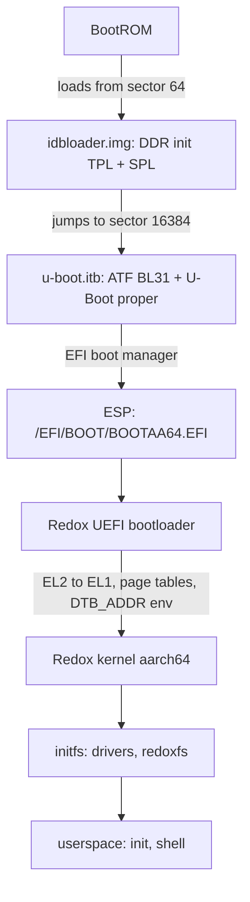

# Redox OS on Pinebook Pro

Porting [Redox OS](https://www.redox-os.org) (aarch64) to the [PINE64 Pinebook Pro](https://pine64.org/documentation/Pinebook_Pro/) (Rockchip RK3399 laptop).

**End goal:** a GitHub Actions workflow that produces a bootable disk image — flash it to a microSD card with `dd`, insert into the Pinebook Pro, and boot Redox OS.

**Current stage:** research / preparation. The implementation checklist below tracks all remaining work.

---

## 1. Target hardware: Pinebook Pro

Verified against the official PINE64 wiki ([Pinebook Pro page](https://wiki.pine64.org/wiki/Pinebook_Pro)):

| Component      | Details                                                                                                                                                                   |
| -------------- | ------------------------------------------------------------------------------------------------------------------------------------------------------------------------- |
| SoC            | Rockchip **RK3399**: 2× Cortex-A72 @ 2.0 GHz + 4× Cortex-A53 @ 1.5 GHz, ARMv8-A (AArch64)                                                                                 |
| RAM            | 4 GB LPDDR4                                                                                                                                                               |
| Storage        | eMMC module (v5.1, HS400, **SDHCI/arasan** `fe330000`), microSD (**DW MMC**), SPI NOR 16 MiB (ships **empty**), M.2 NVMe via PCIe Gen1 x4 (**not bootable** from BootROM) |
| Serial console | UART2 via headphone jack (internal switch), **1500000 baud 8N1**, 3.3 V logic                                                                                             |
| Input          | Keyboard + touchpad are **USB HID** devices behind an internal USB 2.0 hub                                                                                                |
| Display        | 14" 1920×1080 IPS, eDP (BOE NV140FHM-N49); eDP/VOP not driven by U-Boot GOP on all firmwares                                                                              |
| GPU            | Mali-T860MP4 (Midgard) — out of scope, no driver upstream                                                                                                                 |
| Wi-Fi/BT       | AMPAK **AP6256** (Broadcom), Wi-Fi via SDIO, BT via UART                                                                                                                  |
| Audio          | Everest ES8316 codec, RK808 PMIC                                                                                                                                          |
| USB            | 1× USB 2.0 Type-A, 1× USB 3.0 Type-A, 1× USB 3.0 Type-C (OTG + DP alt-mode, power)                                                                                        |
| Boot ROM order | **SPI NOR → eMMC → microSD → USB OTG** (USB-C not bootable)                                                                                                               |
| Recovery       | MaskROM mode via internal Recovery button + `rkdeveloptool`                                                                                                               |

### RK3399 boot chain (from microSD)

The BootROM loads the next stage from **byte offset 32768 (sector 64)** of the boot device:



Mainline U-Boot supports the board as `pinebook-pro-rk3399_defconfig` (DT: `rk3399-pinebook-pro.dts`).
[TOW-Boot](https://github.com/Tow-Boot/Tow-Boot) (an opinionated U-Boot distribution with a friendly boot menu) ships the board as **`pine64-pinebookPro`**.

---

## 2. Redox OS aarch64: current state (research summary)

Sources: `redox-os/kernel`, `redox-os/bootloader`, `redox-os/redox` (build system), Redox Book (`redox-os/book`), `HARDWARE.md`.

### What already exists upstream

| Piece                       | Status                                                                                                                                           | Evidence                                                                 |
| --------------------------- | ------------------------------------------------------------------------------------------------------------------------------------------------ | ------------------------------------------------------------------------ |
| Kernel `aarch64` arch code  | Exists (`kernel/src/arch/aarch64/`)                                                                                                              | `start.rs`, `paging.rs`, `vectors.rs`, `interrupt/`, `device/`           |
| Kernel target spec          | `kernel/targets/aarch64-unknown-kernel.json`                                                                                                     |                                                                          |
| FDT/DTB support             | Kernel consumes DTB via env `DTB_ADDR`/`DTB_SIZE`, exposes `/scheme/kernel.dtb`                                                                  | bootloader `src/main.rs` writes `DTB_ADDR`/`DTB_SIZE`; kernel `src/dtb/` |
| Serial console from DTB     | Supports compatibles `arm,pl011`, `ns16550a`, **`snps,dw-apb-uart`** (16550, u32 MMIO — exactly the RK3399 UART), Amlogic meson                  | `kernel/src/dtb/serial.rs`                                               |
| IRQ chips                   | `gic.rs` (GICv2 — RK3399 GIC-400 is compatible), `gicv3.rs`, bcm2835/2836                                                                        | `kernel/src/arch/aarch64/device/irqchip/`                                |
| Timer                       | ARM generic timer                                                                                                                                | `device/generic_timer.rs`                                                |
| PSCI                        | Supported (`device/psci.rs`) — CPU bring-up / reset                                                                                              |                                                                          |
| UEFI bootloader for aarch64 | Target `aarch64-unknown-uefi` → `BOOTAA64.EFI`; drops EL2→EL1, sets MAIR/TCR/page tables, reads EFI memory map & FDT, passes framebuffer via env | `bootloader/src/os/uefi/arch/aarch64.rs`, `bootloader/src/main.rs`       |
| Build system multi-arch     | `ARCH=aarch64`, `CONFIG_NAME`, `BOARD` vars; image at `build/$ARCH/$CONFIG_NAME/harddrive.img`                                                   | Redox Book, `mk/`                                                        |
| aarch64 configs             | `config/aarch64/{ci,demo,dev,jeremy,redoxer}.toml` + `config/aarch64/raspi3bp/minimal.toml`                                                      |                                                                          |
| QEMU aarch64                | `make qemu` on aarch64 defaults to UEFI (`AAVMF`/`edk2-aarch64`), `-M virt`, `ramfb`, NVMe disk; U-Boot path also available                      | `mk/qemu.mk`                                                             |
| Real-hardware precedent     | **Raspberry Pi 3 B+ (ARM64, U-Boot): "Boots to UART serial console (pl011)"** — i.e. console-only, no storage driver yet                         | `HARDWARE.md`, Book chapter `aarch64.md`                                 |

### What is missing for a usable Pinebook Pro

1. **Storage drivers** for non-PCI hosts: DW MMC (microSD), SDHCI-arasan (eMMC). This is the biggest gap — it is why the RPi 3 B+ only reaches a serial console. Without it there is no root filesystem.
2. **USB host (DWC3/DWC2) + HID** — needed for keyboard/touchpad (they are internal USB devices).
3. **Display**: framebuffer comes from the bootloader (`FRAMEBUFFER_ADDR` env) via EFI GOP; this only works if U-Boot exposes GOP (video driver for eDP in U-Boot). Otherwise console is serial-only until a Rockchip VOP/eDP driver exists.
4. Optional/later: PCIe (NVMe), Wi-Fi AP6256, audio ES8316, RTC, battery/PMIC (RK808/CW2015).

**Pragmatic milestone plan:** serial console boot (parity with RPi 3 B+) → storage → USB input → display → everything else.

---

## 3. Target microSD image layout

The stock Redox installer (`redox-os/installer`) produces a GPT image with the ESP starting at **sector 2048 (1 MiB)** — which collides with the RK3399 requirement of placing `u-boot.itb` at **sector 16384 (8 MiB)**. Our CI therefore **repacks** the stock image: the ESP is recreated at 16 MiB and the U-Boot stages are embedded in the gap. The RedoxFS partition (and all its content) is left untouched.

Final image layout (512-byte sectors):

| Start sector | End sector | Size      | Content                                                        |
| ------------ | ---------- | --------- | -------------------------------------------------------------- |
| 0            | 33         | —         | Protective MBR + GPT header + entries                          |
| 64           | 16383      | ~8 MiB    | `idbloader.img` (RK3399 DDR init + SPL)                        |
| 16384        | ~18783     | ~1 MiB    | `u-boot.itb` (ATF BL31 + U-Boot proper, EFI-capable)           |
| 32768        | 264191     | ~113 MiB  | ESP, FAT32: `/EFI/BOOT/BOOTAA64.EFI` (Redox UEFI bootloader)   |
| 264192       | end        | remainder | RedoxFS (root filesystem with `/usr/lib/boot/{kernel,initfs}`) |

An alternative deployment mode (no image repacking needed): flash U-Boot/TOW-Boot once into the **SPI NOR** (it ships empty), then boot any stock-layout Redox image from microSD. This is documented as a fallback; the CI deliverable is the self-contained microSD image above.

---

## 4. Build system cheat sheet (upstream `redox` repo)

```sh
git clone https://gitlab.redox-os.org/redox-os/redox.git   # upstream primary (GitHub is a mirror)
cd redox

# .config (generated by CI, never committed)
cat > .config <<'EOF'
ARCH?=aarch64
CONFIG_NAME?=pinebook-pro
PODMAN_BUILD?=0
EOF

make all   # -> build/aarch64/pinebook-pro/harddrive.img
```

| Fact                           | Value                                                                                                                                             |
| ------------------------------ | ------------------------------------------------------------------------------------------------------------------------------------------------- |
| Filesystem config resolution   | `config/$ARCH/$BOARD/$CONFIG_NAME.toml`, or `config/$ARCH/$CONFIG_NAME.toml` if `BOARD` is empty; overridable via `FILESYSTEM_CONFIG`             |
| Board-specific config template | `config/aarch64/raspi3bp/minimal.toml`: `include = ["../../minimal.toml"]`, `filesystem_size = 256`, `efi_partition_size = 128`                   |
| ESP size                       | Configurable via `efi_partition_size` in the `[general]` section of the fs config; ESP **offset is fixed at sector 2048** → hence the repack step |
| Image variants                 | `harddrive.img` (disk) and `redox-live.iso` (live, `--live`); we use `harddrive.img`                                                              |
| Image creation                 | `redox-installer` writes GPT (BIOS boot gap, ESP, RedoxFS) and populates RedoxFS; ESP gets the Redox UEFI bootloader                              |
| CI-friendly knobs              | `CI=1` (disables TUI), `REPO_BINARY=1` (prebuilt packages, if published for aarch64), `REPO_OFFLINE=1`, `COOKBOOK_MAKE_JOBS`, `PODMAN_BUILD=0/1`  |
| Helper                         | `./build.sh -A <target>` (`-A` = aarch64), e.g. `./build.sh -A aarch64 -c pinebook-pro all`                                                       |
| Boot test (virtual)            | `make qemu` on aarch64 uses AAVMF + `-M virt`; U-Boot raspi3bp flow uses `-kernel u-boot.bin` + `disk=sdcard`                                     |

---

## 5. CI plan (GitHub Actions)

Single workflow (`build.yml`), stages:

1. **Build Redox aarch64 image** — `ubuntu-24.04` runner, native build (`PODMAN_BUILD=0`, deps per `native_bootstrap.sh`; fallback `PODMAN_BUILD=1`). `ARCH=aarch64`, minimal board config. `CI=1`, verbose logs to files.
2. **Build/fetch U-Boot for RK3399** — primary: build upstream U-Boot (`pinebook-pro-rk3399_defconfig`) with BL31 from ARM Trusted Firmware (`PLAT=rk3399`) → `idbloader.img` + `u-boot.itb`; pinned commits. Alternative: download TOW-Boot release artifact for `pine64-pinebookPro`.
3. **Repack** — `scripts/repack-pbp.sh`: relocate ESP to sector 32768 (`sgdisk` + `mkfs.vfat` + `mtools`), embed U-Boot stages at sectors 64/16384, compress with `zstd`.
4. **Smoke test (QEMU, optional but desired)** — boot the _stock_ (pre-repack) image with `qemu-system-aarch64 -M virt` + AAVMF + serial capture; assert the Redox bootloader banner / kernel messages appear.
5. **Publish** — upload `redox-pinebook-pro-<sha/date>.img.zst` + SHA256 as workflow artifact; cut a GitHub Release on tags.

Notes: runner disk ~14 GB (use `/mnt` for the build tree, prune dotnet/android/ghc), free-tier job wall clock limit is 6 h (a minimal aarch64 build is expected to fit; measure first run, then optimize with `REPO_BINARY=1` and caches).

---

## 6. Implementation checklist

Legend: `[x]` done, `[ ]` open. Keep this section in sync with reality (see `AGENTS.md`).

### Phase 0 — Research & repo scaffolding

- [x] Study Redox build system (vars, image targets, fs configs)
- [x] Study Redox aarch64 kernel/bootloader state (DTB path, UART compatibles, IRQ chips, UEFI flow)
- [x] Study Pinebook Pro hardware, BootROM, flash offsets, serial console
- [x] Write `README.md` (this file) and `AGENTS.md`

### Phase 1 — CI builds upstream aarch64 image (board-independent)

- [ ] `scripts/` + `.github/workflows/build.yml` scaffolding
- [ ] Native (non-Podman) dependency set works on ubuntu-24.04 runner
- [ ] `ARCH=aarch64` minimal image builds green in CI
- [ ] QEMU aarch64 UEFI smoke test passes (serial banner assertion)
- [ ] Upload `harddrive.img.zst` artifact
- [ ] Measure build time & disk usage; decide on `REPO_BINARY`/caching strategy

### Phase 2 — Pinebook Pro image composition (still no hardware required)

- [ ] Board fs config `config/aarch64/pinebook-pro/minimal.toml` (start from raspi3bp/minimal.toml)
- [ ] Confirm installer GPT layout assumptions (ESP at sector 2048; `efi_partition_size` honored)
- [ ] `scripts/repack-pbp.sh`: ESP → sector 32768, embed U-Boot at 64/16384, zstd; verify with `sgdisk -p` + `mtools -l`
- [ ] U-Boot built from source in CI (pinned ATF + U-Boot, `pinebook-pro-rk3399_defconfig`)
- [ ] Fallback: TOW-Boot `pine64-pinebookPro` release artifact fetch mode
- [ ] Tag-driven GitHub Release with final image + SHA256

### Phase 3 — Hardware bring-up: serial console (milestone = parity with RPi 3 B+)

- [ ] Prep device: UART cable (3.3 V) @ **1500000 8N1**; optionally flash TOW-Boot to SPI
- [ ] Boot SD image: `BOOTAA64.EFI` banner visible on UART
- [ ] Kernel entered at EL1, DTB discovered (`DTB_ADDR` env honored), UART bound (`snps,dw-apb-uart`)
- [ ] GIC-400 (GICv2) + generic timer initialized
- [ ] Reach initfs / login shell over serial

### Phase 4 — Storage, input, display

- [ ] Decide driver architecture for platform (non-PCI) devices in current Redox (kernel `dtb` drivers vs userspace daemons) — inspect how raspi3bp handles it
- [ ] DW MMC driver (microSD) → root filesystem from microSD
- [ ] SDHCI-arasan driver (eMMC)
- [ ] USB: DWC3 (xHCI-compatible) host + HID → keyboard/touchpad
- [ ] Display: U-Boot GOP → `FRAMEBUFFER_*` env → console on eDP panel (evaluate whether `pinebook-pro-rk3399` U-Boot ships video/GOP; else enable it)
- [ ] Optional: PCIe (dw-pcie) + NVMe storage

### Phase 5 — Polish & upstreaming

- [ ] Wi-Fi AP6256 (SDIO Broadcom), BT (UART)
- [ ] Audio ES8316, RTC, RK808 PMIC, battery CW2015
- [ ] Reproducible builds: pinned redox/U-Boot/ATF revisions, artifact hashes
- [ ] Upstream: fs config + patches to `gitlab.redox-os.org` (MRs), extend Redox Book aarch64 chapter with Pinebook Pro

---

## 7. Risks & open questions

| #   | Risk / question                                                       | Status / mitigation                                                                                                                                                    |
| --- | --------------------------------------------------------------------- | ---------------------------------------------------------------------------------------------------------------------------------------------------------------------- |
| 1   | ESP offset fixed at sector 2048 collides with `u-boot.itb` @ 16384    | Solved by design: repack step (recreate ESP at 32768). Verify installer behavior in Phase 2                                                                            |
| 2   | U-Boot must pass FDT via EFI config table and provide GOP for display | FDT: standard U-Boot `efi_loader` behavior, and Redox bootloader consumes it (`OsHwDesc::DeviceTree`). GOP: verify on device; worst case serial-only console initially |
| 3   | No storage driver for DW MMC/SDHCI upstream on aarch64                | Known gap (RPi 3 B+ precedent). Phase 4; expect kernel/userspace driver work in `redox-os/drivers` or kernel `dtb` devices                                             |
| 4   | Build time/disk on free CI runners                                    | Measure in Phase 1; mitigations: minimal config, `REPO_BINARY=1`, caching, pruning runner disk                                                                         |
| 5   | UART baud 1500000 unusual for some USB-UART dongles                   | Use CP2102/FT232/CH340-class adapter; bootloader/kernel must not re-init UART to another rate (DTB `stdout-path` baud respected by kernel DTB serial)                  |
| 6   | eMMC-only units (no SD) / SPI-bricked devices                         | Document maskrom + `rkdeveloptool` recovery in flashing docs                                                                                                           |
| 7   | aarch64 package binaries on Redox repo server                         | Verify availability; else build all from source                                                                                                                        |

---

## 8. References

### Redox OS

- Build system: https://gitlab.redox-os.org/redox-os/redox (mirror: https://github.com/redox-os/redox)
- Kernel: https://github.com/redox-os/kernel (`src/arch/aarch64/`, `src/dtb/serial.rs`, `targets/aarch64-unknown-kernel.json`)
- Bootloader: https://github.com/redox-os/bootloader (`src/os/uefi/arch/aarch64.rs`, `src/main.rs` — `DTB_ADDR`/`DTB_SIZE`, framebuffer env)
- Installer: https://github.com/redox-os/installer
- Book (sources): https://github.com/redox-os/book — chapters `aarch64.md`, `boot-process.md`, `configuration-settings.md`, `real-hardware.md`; rendered: https://doc.redox-os.org/book/
- Hardware compat: https://github.com/redox-os/redox/blob/master/HARDWARE.md (RPi 3 B+ ARM64 row)
- AArch64 port outline: https://github.com/redox-os/kernel/blob/master/ARM-AARCH64-PORT-OUTLINE.md
- Firmware blobs used by Redox (raspi/qemu U-Boot): https://gitlab.redox-os.org/Ivan/redox_firmware

### Pinebook Pro / RK3399

- Official docs: https://pine64.org/documentation/Pinebook_Pro/
- PINE64 wiki (hardware, boot, SPI, serial): https://wiki.pine64.org/wiki/Pinebook_Pro
- U-Boot (mainline, `pinebook-pro-rk3399_defconfig`): https://source.denx.de/u-boot/u-boot
- TOW-Boot (board `pine64-pinebookPro`): https://github.com/Tow-Boot/Tow-Boot
- ARM Trusted Firmware: https://github.com/ARM-software/arm-trusted-firmware (`PLAT=rk3399`)

## License

Same as the project originally started with (see `LICENSE`).
